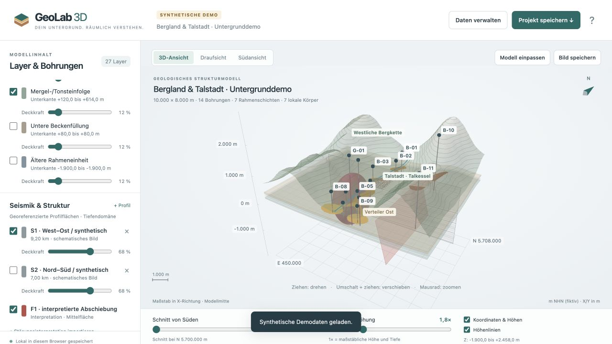

# GeoLab 3D

**[Website öffnen](https://frederikurbancy29.github.io/3D-geological-Model-/)** · [Quellcode und Änderungen](https://github.com/frederikurbancy29/3D-geological-Model-)

Lokale GIS-Arbeitsoberfläche mit 2D-/3D-Ansichten, mehreren Projekten, bearbeitbaren Informationslayern und nachvollziehbaren Modellberechnungen. Die geologische Demo enthält Gelände, regionale Schichten, lokale Ablagerungskörper, Granitintrusion, Bohrungen und Seismikprofile. Die Beispieldaten sind synthetisch.



## Benutzen

Die veröffentlichte Website funktioniert ohne Installation. Alternativ die Datei `dist/index.html` herunterladen und in einem aktuellen Browser mit WebGL öffnen.

- Modell mit der Maus oder per Touch drehen, verschieben und zoomen.
- Gelände, einzelne Schichten, Fazieskörper, Intrusion, Bohrungen und Geolayer getrennt schalten.
- Über **Ansicht** und **Werkzeuge** nur benötigte Bedienfelder hinzufügen: Layer schneiden, Höhenüberhöhung, Koordinatengitter, Messen, Schnittprofil und Datenprüfung. Jedes Feld lässt sich schließen; die Werkzeugauswahl gehört zum Projekt.
- Deckkraft, Schnittposition und Höhenüberhöhung verändern.
- Bohrungen mit Spaltenzuordnung und Importvorschau laden; Intervalle, Ansatz und Endtiefe bearbeiten.
- Zugeordnete Bohrkontakte mit Modellgrenzen vergleichen; Intervalle im Schnittprofil auswählen und im 3D-Modell wiederfinden.
- Numerische 2D-Messraster mit NoData, Farbskala und Einzelwertabfrage anzeigen; optional als Ebene oder auf dem Gelände in 3D.
- Eigene tiefenkonvertierte Seismikbilder als PNG/JPG georeferenzieren.
- Projekte neu erstellen, kopieren, archivieren und als Datei sichern; getrennte Speicherung in IndexedDB.
- Eigene Gruppen direkt im Layerbereich erstellen, umbenennen und verwalten; auch leere Gruppen bleiben im Projekt erhalten.
- Layer über den Pfeil am Eintrag, die Gruppenauswahl rechts oder die Gruppenauswahl mit Häkchen zuordnen. Gruppen lassen sich einklappen und entfernen; ihre Layer bleiben erhalten.
- Layer sperren, einfärben und entfernen; entfernte Layer aus der Datenablage wieder einladen.
- GeoJSON mit Originaldatei und Herkunft importieren; getrennte Layer- und Objektattribute bearbeiten.
- Attributtabelle filtern, sortieren, Auswahl bearbeiten und als CSV exportieren; Objekte per Rechteck auswählen.
- GIS-Stützpunkte numerisch bearbeiten, Geometrien um ein angegebenes Zentrum drehen und verschieben; in 2D mit Fangtoleranz zeichnen.
- Strecken, Winkel, Flächen und Gitterkörpervolumen mit Raumbezug, Methode und Datenrevision protokollieren.
- Geologische Schnittprofile berechnen und die abgetasteten Werte exportieren.

Die Demo enthält eine Fläche von 10 × 8 km, Bergketten und eine Talstadt, sieben regionale Rahmenschichten, sechs lokale Ablagerungskörper, eine Granitintrusion, vierzehn Bohrungen, zwei Profilflächen und eine Störungsinterpretation.

## Eigene Daten

1. **Projekte → Leeres Projekt** erstellt einen eigenen Arbeitsstand. **Daten verwalten → Alle Modelldaten löschen** leert das aktive Projekt einschließlich seiner projektbezogenen Datenablage.
2. Die passende Vorlage herunterladen, bearbeiten und wieder importieren.
3. **Projekt speichern** sichert Daten und Ansicht in einer JSON-Datei.

Importierte Dateien werden im Browser verarbeitet und nach Möglichkeit dort gespeichert. Die Website lädt diese Daten nicht auf GitHub hoch und synchronisiert sie nicht zwischen Personen oder Geräten. Für eine dauerhafte Sicherung die Projektdatei exportieren.

### Unterstützte Datenformate

| Inhalt | Direkter Import | Voraussetzungen |
| --- | --- | --- |
| Bohransätze und Intervalle | CSV, TSV, TXT, XLSX, XLS, XLSB, ODS, JSON-Tabellen; GeoJSON-Punkte als Ansatzpunkte | Gemeinsame Tabelle oder getrennte Ansatz-/Intervalltabellen; Zuordnung der Spalten und Einheiten im Importdialog |
| Geotechnische Bohrdaten | AGS4: LOCA und GEOL | Einheiten und Feldzuordnung bestätigen; weitere AGS-Gruppen bleiben in der Originaldatei |
| Kontinuierliche Bohrlogs | LAS 1.2/2.0 (Well Log) | Ansatzpunkt, Tiefenkurve, Einheiten und Raumbezug bestätigen; keine LiDAR-Punktwolken und keine automatische Lithologieableitung |
| Numerische 2D-Messungen | GeoTIFF (ein numerisches Band), ESRI ASCII, regelmäßige XYZ/CSV/TSV/TXT-Tabellen, Excel/ODS, Surfer DSAA/DSBB/DSRB, Raster-JSON | Georeferenzierung und Messgröße prüfen; unregelmäßige Messpunkte werden ausdrücklich abgewiesen; Surfer 7 ohne Rotation |
| Kartenbilder | PNG/JPG mit Worldfile oder manuell bestätigter Ausdehnung | Bildfarben sind keine numerischen Messwerte |
| Vektoren | GeoJSON-FeatureCollection | Point, LineString und Polygon ohne Löcher; eigener Quellbezug |
| Modellgeometrie | Dokumentierte CSV-Gitter und GeoLab-JSON | Terrain, Schichten, lokale Körper und Paläorelief als Ober-/Unterkanten-Gitter |
| Seismik | Georeferenziertes PNG/JPG-Profilbild | Bereits tiefenkonvertiert; Zeitseismik benötigt vorher eine fachliche Zeit-Tiefen-Konvertierung |

Shapefile, GeoPackage, SEG-Y, LiDAR-LAS/LAZ, LAS 3 und proprietäre Bohrdatenbanken werden noch nicht direkt gelesen. Solche Daten vorher in ein passendes Austauschformat exportieren. Die Liste beschreibt den tatsächlichen Umfang, keine universelle Formatunterstützung.

### Bohrdaten, Schnitt und 2D-Messungen

**Daten laden → Bohrdaten und Intervalle** liest eine Datei bzw. getrennte Ansatz- und Intervalltabellen. Bei Excel stehen die Tabellenblätter einzeln zur Auswahl. Erforderlich sind eine stabile Bohrungs-ID, X/Y, absolute Ansatzhöhe und positive Intervalltiefen von/bis. Endtiefe, Lithologie sowie ausdrückliche Schicht- oder Körperzuordnung sind weitere Felder. Fußwerte lassen sich bewusst in Meter umrechnen. Überlappungen, widersprüchliche Ansätze und unbekannte Referenzen werden vor der Übernahme abgewiesen. Nicht beschriebene Abschnitte werden als Lücken ausgewiesen. Derzeit werden vertikale Bohrungen unterstützt.

Nach Auswahl einer Bohrung öffnen **Intervalle bearbeiten**, **Mit Modell vergleichen** und **Im Schnittprofil ansehen** den Arbeitsablauf. Eine Lithologiebezeichnung allein stellt keine Modellzuordnung her. Der Vergleich verwendet nur ausdrücklich zugeordnete Horizonte/Körper und zeigt `beobachtete Kontakthöhe − Modellhöhe` in Metern. Er ändert keine Körpergeometrie. Bohrungen können als Modellgrundlage oder unabhängige Kontrolle gekennzeichnet werden; synthetische Bohrungen sind keine unabhängige Validierung.

Im geraden Schnittprofil werden Bohrungen innerhalb einer wählbaren Korridorbreite auf die Schnittlinie projiziert; der tatsächliche seitliche Abstand bleibt sichtbar. Horizonte werden an 201 Stationen bilinear abgetastet. Ein Klick auf ein Intervall verknüpft Profil, Bohrungsauswahl und 3D-Markierung. Ein optionales Messrasterprofil besitzt eine eigene Messwertachse, getrennt von der Höhenachse.

**Daten laden → 2D-Messraster und Karten** lädt beispielsweise Magnetik. Originalwerte und NoData bleiben erhalten; Abfragen lesen den betroffenen Originalrasterwert. Eine Darstellung auf Gelände oder fester Z-Ebene ist eine Visualisierung: nT-Werte werden niemals zu Höhen umgedeutet. Die angebotene Magnetik-Demo enthält frei erfundene Farbanomalien ohne physikalischen Bezug zur Intrusion; sie ist keine magnetische Vorwärtsrechnung oder Inversion.

Grenzen: 32 MB pro Importdatei, maximal 262.144 numerische Rasterzellen pro Layer, 100 Rasterlayer, Kartenbilder höchstens 2.048 Pixel je Seite / 4.194.304 Pixel. Große Raster vorher räumlich ausschneiden. Projektdateien dürfen bis 128 MB groß sein; Browserplatz und Geräteleistung begrenzen die praktische Größe. Bohrlogs: höchstens 100.000 Tiefenzeilen, 64 Kurven und insgesamt 1.000.000 Werte. Originaldateien bleiben zusätzlich zur bearbeitbaren Kopie im Projekt erhalten.

Die zusammenpassenden [Vorlagen](dist/vorlagen) verwenden **LOCAL / lokale Meter**. Zum Testen zuerst `projektvorlage.geolab.json` öffnen und danach `10-bohrdaten.xlsx` oder `08-bohransatzpunkte.csv` plus `09-bohrintervalle.csv` importieren. „Synthetische Daten“ bestätigen. Die Magnetikbeispiele 11–14 enthalten dieselben frei erfundenen Werte in verschiedenen Formaten; das ASCII-Beispiel verwendet einen quadratischen Zellausschnitt. Für das große UTM-Demomodell direkt den angebotenen **Magnetik-Demoraster** verwenden.

### Raumbezug und Rechentreue

Als metrische Projektbezüge stehen lokale Meterkoordinaten, ETRS89/UTM 32N und 33N sowie WGS84/UTM 32N und 33N bereit. GeoJSON kann aus EPSG:4258 bzw. EPSG:4326 oder der jeweils anderen unterstützten UTM-Zone innerhalb **derselben Datumsfamilie** projiziert werden. Die Anwendung setzt WGS84 und ETRS89 nicht gleich. Die reguläre UTM-Zone und Nordhalbkugel werden geprüft. Koordinaten mit vorangestellter Zonenkennziffer werden nicht als gewöhnliche UTM-Rechtswerte umgedeutet.

Lage- und Höhenbezug müssen bestätigt werden. Die Zuweisung eines Projektbezugs ändert keine vorhandenen Zahlen. Modellgeometrien aus CSV müssen bereits im Projektbezug vorliegen. Der neue Bohr- und Rasterimport berücksichtigt einen ausdrücklich gewählten unterstützten Quellbezug innerhalb derselben Datumsfamilie. Rasterwerte bleiben in ihrem Quellgitter; ausschließlich die Darstellung wird projiziert. Es gibt keine Datums-, Epochen-, Quasigeoid- oder NHN-Umrechnung. Für Bayern ist DHHN2016 als Höhenreferenz auswählbar; dies validiert die Höhe einer Quelldatei nicht automatisch.

Berechnungen verwenden die gespeicherten Zahlen in doppelter Genauigkeit, unabhängig von GPU-Darstellung, Kamera, Schnitt und Höhenüberhöhung. Gitterstrecke, ellipsoidische Geodäte und örtliche Bodenstrecke sind unterschiedliche Größen. Die 3D-Strecke ist eine Strecke im metrischen Projektkoordinatenraum. Flächen sind wahlweise horizontal projiziert oder aus angegebenen 3D-Polygonstützpunkten trianguliert. Volumen beziehen sich auf das vollständige Ober-/Unterkanten-Gitter, trianguliert entlang SW–NE; überlappende Körper werden nicht gegenseitig abgezogen. Unsicherheiten der Eingabedaten und geologischen Interpretation bleiben bestehen.

Numerische Bearbeitung verändert derzeit GIS-Punkte, Linien und einfache Flächen. Geologische Körper bleiben Ober-/Unterkanten-Gitter; beliebige überhängende Volumennetze, automatische Störungsversätze oder ein geologischer Interpolationssolver sind nicht enthalten. Bohrintervalle sind zusätzlich direkt in der Anwendung bearbeitbar; geologische Gitter werden über validierte Datendateien ausgetauscht.

Alte Einzelprojekte werden beim ersten Öffnen übernommen. Die frühere Browserablage wird nicht gelöscht. Die letzten acht Änderungen lassen sich in der aktuellen Sitzung rückgängig machen; das dauerhafte Änderungsprotokoll enthält Beschreibungen, keine vollständige Versionshistorie. Projektkopien sichern alternative Szenarien.

- [Anleitung und Datenformate](dist/ANLEITUNG.txt)
- [Geologische Grundlagen, Quellen und Modellannahmen](dist/GEOLOGISCHES_KONZEPT.txt)
- [Zusammenpassende Beispieldateien](dist/vorlagen)

## Auf GitHub Pages veröffentlichen

Dieses Repository enthält den Workflow `.github/workflows/pages.yml`:

1. Das Projekt in ein GitHub-Repository mit dem Standardbranch `main` übertragen.
2. Im Repository **Settings → Pages → Build and deployment → Source → GitHub Actions** auswählen.
3. Unter **Actions** den Workflow **GeoLab 3D prüfen und veröffentlichen** starten oder eine Änderung nach `main` übertragen.
4. Die veröffentlichte Website wird unter **Settings → Pages** und beim abgeschlossenen Deployment verlinkt.

Änderungen an `main` werden erst nach erfolgreichen Daten- und Geometrieprüfungen veröffentlicht. Pull Requests werden geprüft und veröffentlichen keine Website. Es werden ausschließlich die Dateien aus `dist/` als Website bereitgestellt.

Die Website und die im Repository abgelegten Beispieldateien sind je nach Pages-Konfiguration öffentlich erreichbar. Eigene vertrauliche Dateien gehören nicht in das veröffentlichte Repository. Lokale Arbeitsdateien können außerhalb des Projekts oder in den ignorierten Ordnern `local-data/`, `private-data/` und `exports/` liegen.

## Lokal weiterentwickeln

Die Website benötigt keinen Anwendungsserver. Proj4js 2.23.0, GeographicLib-Geodesic 2.2.0, SheetJS CE 0.20.3 und geotiff.js 3.0.5 sind mit Lizenztexten lokal eingebunden; zur Laufzeit werden keine Bibliotheken aus dem Internet nachgeladen. Zum Neuerstellen werden Python 3 und Node.js 24 verwendet; eine Paketinstallation ist nicht erforderlich.

```sh
node --test core.test.cjs sedimentary.test.cjs integration.test.cjs workspace.test.cjs field.test.cjs
python3 build.py
node examples.cjs
```

`build.py` verbindet die Quelldateien zu einer eigenständig nutzbaren HTML-Datei. `examples.cjs` erstellt die austauschbaren Datenvorlagen.

Die 70 automatisierten Prüfungen umfassen unabhängige PROJ-/GeographicLib-Referenzwerte, analytisch bekannte Strecken, Flächen, Winkel und Volumen, verbotene Datums-/Höhenwechsel, Polygonfehler, Fangtoleranzen, Projekttrennung, Originaldaten und die vorhandene geologische Demo. Zusätzliche Prüfungen umfassen echte XLSX-/ODS- und Float32-GeoTIFF-Dateien, ASCII-/XYZ-/Surfer-Georeferenzierung, NoData, bekannte Kontaktabweichungen, Bohrdatenfehler und Projekt-Rundläufe. Browserprüfungen ergänzen Importvorschau, Intervallbearbeitung, 3D-/Profilabgleich, optionale Werkzeuge, Projektwechsel, Speichern/Wiederöffnen, Attributbearbeitung, numerische Drehung, Rückgängig und Wiederherstellung entfernter Layer.

### Grundlagen der Koordinatenberechnungen

- [Proj4js: Definitionen und Achsreihenfolge](https://proj4js.org/)
- [GeographicLib: Geodäten und Referenzbeispiel](https://geographiclib.sourceforge.io/html/js/)
- [PROJ: unabhängiger UTM-Referenzwert](https://proj.org/en/stable/usage/quickstart.html)
- [Bayerische Vermessungsverwaltung: Referenzsysteme und Höhen](https://www.ldbv.bayern.de/vermessung/satellitenpositionierung/grundlagen.html)
- [BKG: Übergang zwischen ellipsoidischer Höhe und DHHN2016](https://gibs.bkg.bund.de/geoid/gserlaeuter_g.php)

### Grundlagen der Importformate

- [SheetJS: lokale Standalone-Bibliothek](https://docs.sheetjs.com/docs/getting-started/installation/standalone/)
- [geotiff.js: GeoTIFF-Lesen und Metadaten](https://geotiffjs.github.io/geotiff.js/)
- [Esri: ASCII-Raster, Zellursprung und Zeilenreihenfolge](https://resources.arcgis.com/en/help/main/10.1/009t/009t0000000z000000.htm)
- [Surfer: ASCII-Gitter](https://surferhelp.goldensoftware.com/topics/ascii_grid_file_format.htm)
- [Surfer 7: binäre Gitter](https://surferhelp.goldensoftware.com/topics/surfer_7_grid_file_format.htm)

## Fachlicher Umfang

Diese Anwendung stellt ein geologisches Strukturmodell dar. Konkrete Körpergrenzen, Ablagerungsumgebungen, Intrusionskontakte und Paläorelief der Demo sind vorgegebene Annahmen. Die Literatur belegt allgemeine Prozesse und Methoden, keine reale Demo-Lokalität.

Die Anwendung rekonstruiert keine Körper automatisch aus Bohrungen, bestimmt keine Störungen automatisch aus Seismik und berechnet keine Versenkungshistorie. Grundwasser-, Wärme- und geomechanische Prozesssimulationen sind nicht enthalten.

## GitHub-Dokumentation

- [GitHub Pages und unterstützte Konten](https://docs.github.com/en/pages/getting-started-with-github-pages/what-is-github-pages)
- [Veröffentlichung mit GitHub Actions einrichten](https://docs.github.com/en/pages/getting-started-with-github-pages/configuring-a-publishing-source-for-your-github-pages-site)
